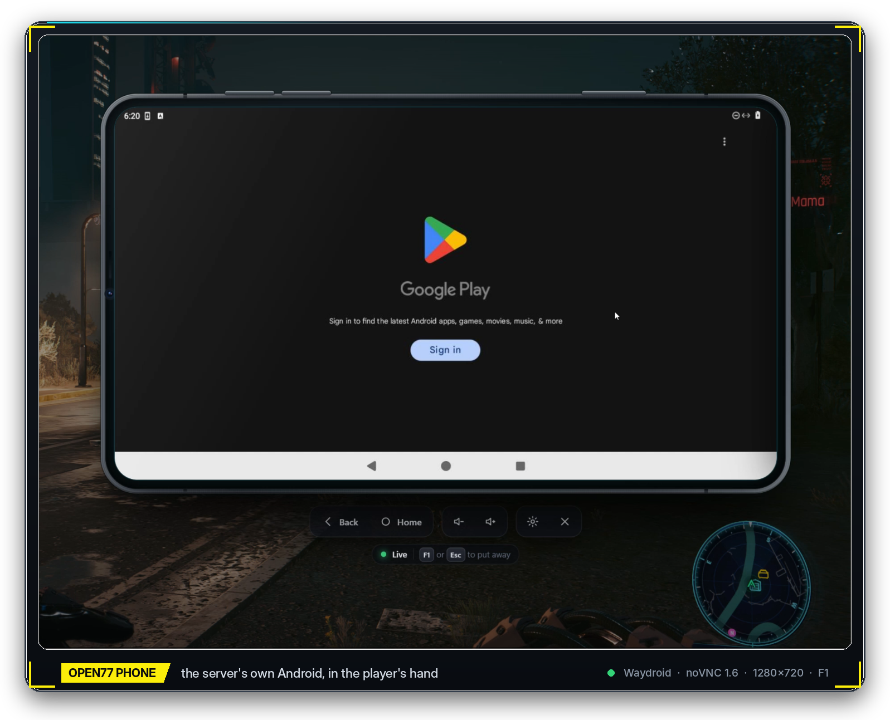
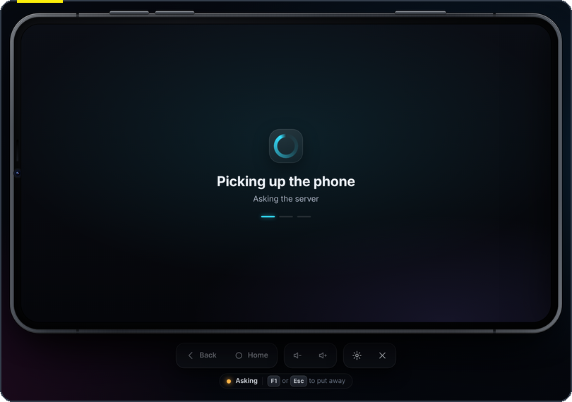
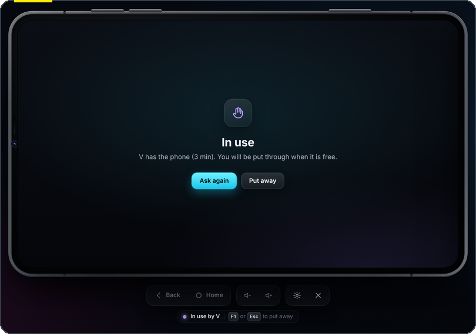
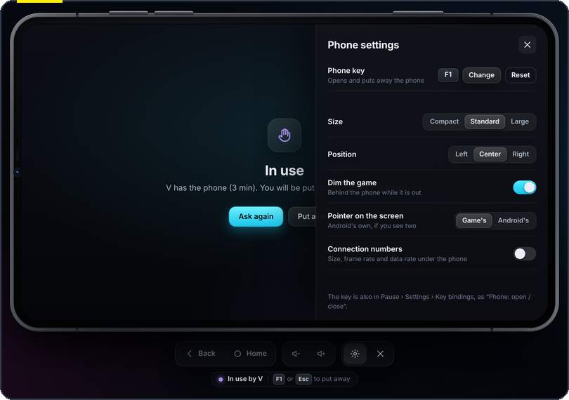
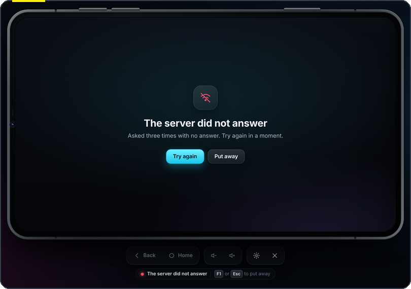
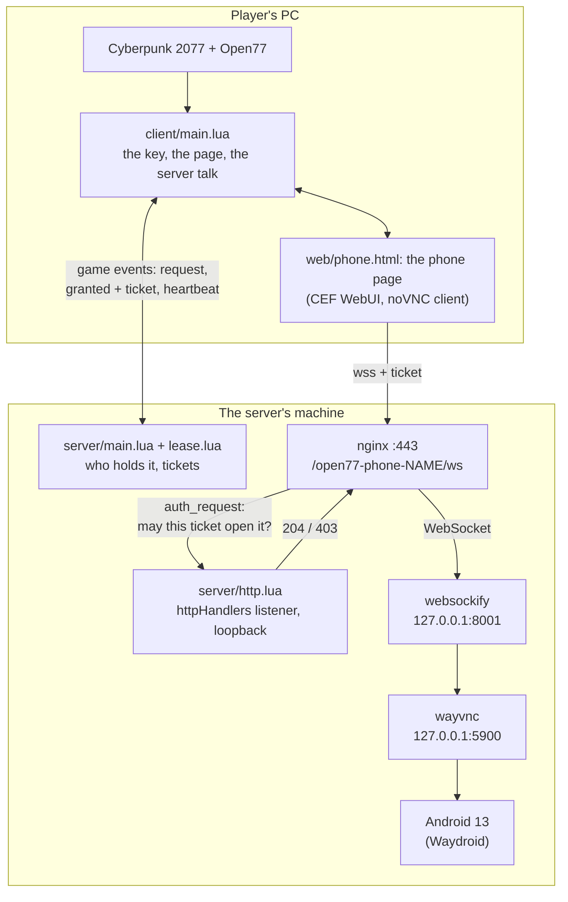
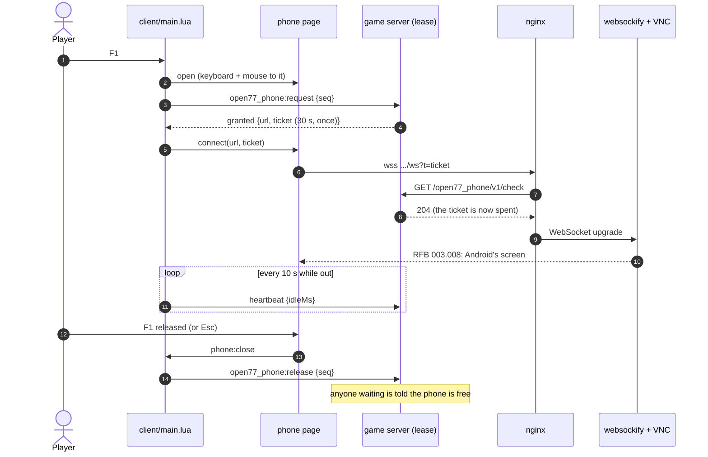

<div align="center">



# open77-phone

**The game server's own Android, in the player's hand.**

An in-game phone for [Open77](#what-is-open77) servers (Cyberpunk 2077 multiplayer). Press **F1** and
a phone comes up over the game with a real **Android 13** on it, running on the server's own machine:
Play Store, browser, apps. You drive it with your mouse and keyboard.


[**Download for your server**](https://github.com/nobody71004/open77-phone/releases/latest) ·
[**Install guide**](docs/INSTALL.md) ·
[How it works](#how-it-works) ·
[Security](#security) ·
[Versions](#versions)

</div>

---

## Contents

- [What it does](#what-it-does)
- [A look at it](#a-look-at-it)
- [Putting it on your server](#putting-it-on-your-server)
- [Using it in game](#using-it-in-game)
- [One Android, one player at a time](#one-android-one-player-at-a-time)
- [How it works](#how-it-works)
- [Security](#security)
- [Logs](#logs)
- [The web server's side: `tools/phone_server.py`](#the-web-servers-side-toolsphone_serverpy)
- [What is in this repository](#what-is-in-this-repository)
- [Tests](#tests)
- [Building the release package](#building-the-release-package)
- [Versions](#versions)
- [Limits](#limits)
- [What is Open77](#what-is-open77)
- [License and credits](#license-and-credits)

## What it does

- **A real Android, not a picture of one.** The phone shows the Android the game server's machine
  runs: Waydroid, Android 13 with Google apps, on the host's own kernel. It's the same device the TV
  rooms' Android tile shows. Apps you install stay installed.
- **Mouse and keyboard.** Click, drag, scroll and type on the screen as on a touch screen with a
  keyboard. Back, Home and volume are under the phone and on its side keys.
- **Your key.** F1 by default. Move it in **Pause › Settings › Key bindings**, in the phone's own
  settings, or with `/phonekey`. The game keeps the choice on your machine, for every server.
- **Made to look like a phone.** A graphite body with a rim, side keys and a camera, drawn over a
  dimmed game. Three sizes, three positions, and a status pill that says what it is doing.
- **One Android, shared fairly.** One player holds it at a time. Everyone else sees who has it and
  for how long, and is put through when it is free. A holder whose game goes quiet or who leaves it
  untouched while others wait gives it up.
- **Nothing reaches Android without a ticket.** The screen is reached only through the web server,
  behind a check that asks the game server about every connection. Each ticket opens once, within
  30 seconds, for the player who holds the phone, from that player's own address.
- **It says what it is doing.** Every step goes to the client and server logs, prefixed
  `[open77_phone]`. No log line ever holds a ticket.

## A look at it

<table>
<tr>
<td width="50%"><br><sub><b>Picking up the phone.</b> F1, and the server is asked. When the answer comes, the screen opens through the ticket check.</sub></td>
<td width="50%"><br><sub><b>In use.</b> One Android, one player. You see who has it and for how long, and you are put through when it is free.</sub></td>
</tr>
<tr>
<td width="50%"><br><sub><b>Settings.</b> The key (<i>Change</i> takes the next key you press), size, position, dimming, whose pointer shows on the screen, and the connection numbers.</sub></td>
<td width="50%"><br><sub><b>When something is wrong, it says so</b> and offers the way out: <i>Try again</i> or <i>Put away</i>.</sub></td>
</tr>
</table>


**Put away while you wait?** When the phone frees up, a note in the corner tells you, with your key.

<br clear="right">

## Putting it on your server

Server owners: download **`open77-phone-<version>.zip`** from
[Releases](https://github.com/nobody71004/open77-phone/releases/latest). It holds the resource, the
web server script, an nginx example and the step-by-step **[install guide](docs/INSTALL.md)**. In
short:

| | step | notes |
|---|---|---|
| 1 | Android's screen on the machine as VNC, behind websockify on loopback | [open77-tv's Waydroid stack](https://github.com/nobody71004/open77-tv/tree/main/shared-browser/android-native) does this |
| 2 | Copy `resources/open77_phone/` into your game server, add it to `resources.load` | |
| 3 | Set `wsUrl` in `open77_phone/server/config.lua` | `wss://YOUR.HOST/open77-phone-NAME/ws` |
| 4 | Turn on the `httpHandlers` listener in `server.jsonc`, on loopback | `http://127.0.0.1:11781` |
| 5 | Restart, and read the phone's first log line | `[open77_phone] v1.0.2: the screen is wss://...` |
| 6 | `python3 phone_server.py fix ...` as root: the two nginx locations, checked end to end | or paste the example by hand |

Needs an Open77 dedicated server you can restart, root on its machine, nginx with TLS for your
players' host, and Python 3.8+ for the script.

## Using it in game

| press or type | what it does |
|---|---|
| **F1** (your key), or `/phone` | take out the phone; F1 again or **Esc** puts it away, on the key's release |
| click, drag, wheel, type | on Android's screen, as touches and a keyboard |
| **Back**, **Home**, **−** / **+** | under the phone (Android's own Back, Home and volume keys) |
| **power key**, **×** | put it away |
| **gear** | settings |
| `/phonekey <key>` | move the key (`/phonekey page up`, `/phonekey reset`; `/phonekey` alone opens the key chooser) |
| `/phonestatus` | who has the phone, and how many wait (at the server console: every count since start) |

Keys you walk, aim, talk or interact with (W A S D, Space, Shift, Ctrl, Alt, Tab, Enter, Esc, T, F,
E, R, Backspace, the two main mouse buttons) cannot become the phone key. Where the game can, the key is
registered as consumed, so it does nothing else while it opens the phone.

**Settings** are kept per server, on the player's machine:

| setting | choices | what it does |
|---|---|---|
| Size | Compact · Standard · Large | how big the phone is drawn |
| Position | Left · Center · Right | where it sits on the screen |
| Dim the game | on / off | darken the game behind the phone while it is out |
| Pointer on the screen | Game's · Android's | if two pointers show, hide the game's over the screen |
| Connection numbers | on / off | size, frame rate and data rate under the phone |

## One Android, one player at a time

The server decides who holds the phone (`server/lease.lua`):

| when | then |
|---|---|
| first to ask gets it | and keeps it while their game says it is still out (a heartbeat every 10 s) |
| put away, or leave the server | free again at once; whoever waits is told |
| game goes quiet for **45 s** | a crash or a dropped link: the phone is taken back |
| untouched for **10 min** | taken back, but only while somebody else is waiting |
| busy | *In use: V has the phone (3 min)*, and you are put through when it is free |

Every opening is counted, and the server ignores a put-down that arrives after the next opening's
request. So a quick close and reopen never takes back the fresh ticket.

## How it works





The page is a remote-policy WebUI page made by the client script, not by the manifest. The game
may still be preparing the resource's files when the client half starts (`resource_preparing`), so
the page is tried again every 3 s until it exists, and once more when the key is pressed. The VNC
client is noVNC 1.6.0's RFB, bundled as one classic script (`web/vendor/novnc-rfb.js`, built by
`build/`). The screen is scaled into the phone. Pointer and keys go to Android, except the phone's
own key and Escape, which the page keeps.

## Security

| what | how |
|---|---|
| **Tickets** | 32 hex digits (128 bits), made by the game server for the player who holds the phone; open the screen **once**, within **30 s**, and only while that player still holds it. They come from Lua's `math.random`, which is not a cryptographic generator, so the rows below matter too |
| **Bound to the player's address** | when the game knows where the player plays from, the WebSocket must come from there (nginx says in `X-Real-IP`); an IPv4 player seen over IPv6 cannot be compared and is let through |
| **One way in** | keep websockify and VNC on loopback or a private bridge, never on a public address (whatever reaches them drives Android with no password); then the nginx route behind its ticket check is the only way to Android's screen from outside |
| **The check is internal** | the route's `/open77-phone-NAME/auth` location is `internal` (no request from outside reaches it), and the game server's listener stays on loopback |
| **Selftest tickets** | `POST /open77_phone/v1/selftest` answers loopback callers only, ten per start of the resource: how the web server script proves the route without a player |
| **Logs** | no ticket is ever logged, by the page, the client, the server or the script; nginx's two locations keep no access log; a player's address is kept with its ticket and never logged |
| **Permissions** | the resource asks for exactly `network.events`, `input.actions`, `http.serve`, `players.identity.sensitive` |

Refusals carry a reason, in the server log only: `no_ticket`, `malformed_ticket`, `unknown_ticket`,
`ticket_used`, `ticket_expired`, `not_the_holder`, `other_address`.

## Logs

The client (the game's log, `red4ext/logs/open77-*.log`):

```text
[open77_phone] no page yet (resource_preparing; try 1, start): the game is still preparing this resource's files; trying again
[open77_phone] key F1 (registered, consumed)
[open77_phone] settings: standard, on the right, game dimmed, numbers hidden, pointer game (read ahead, in 7 ms)
[open77_phone] page created (may reach the phone's screen) on try 2, 3.2 s after the first (retry)
[open77_phone] opened (key, opening 1); keyboard and mouse to the phone: yes; asking the server
[open77_phone] the phone is ours (picked up); opening the screen at play.example.net
[open77_phone] screen live -- 1280x720, attempt 1
[open77_phone] closed (key, opening 1); the phone is free for others
```

The server (the game server's log):

```text
[open77_phone] v1.0.2: the screen is wss://play.example.net/open77-phone-rp/ws; the web server's check on /open77_phone/; ...
[open77_phone] player 3 (V): the phone is theirs (picked up; key); a ticket for 30 s
[open77_phone] check: let through (player 3; original; the player's own address)
[open77_phone] player 3 (V): the phone live -- 1280x720, attempt 1
[open77_phone] player 3 (V): put the phone down (key)
```

The full list of what each side logs, and what each line means, is in
[`open77_phone/README.md`](open77_phone/README.md#what-it-logs). The install guide's
[table](docs/INSTALL.md#when-it-does-not-work) goes from a symptom to its log line and the fix.

## The web server's side: `tools/phone_server.py`

Run as root on the machine (Python 3.8+, nothing to install). Every mode prints what it saw and
ends with `PHONE result: {...}`. It never prints a ticket.

| mode | what it does |
|---|---|
| `look` | **read only**: the nginx site serving your host on 443 (file, block, phone locations already there); the game server (listener, open77_phone installed and answering, its `wsUrl`); websockify and VNC (the greeting, the security it asks for, the screen's size); what the route answers now |
| `fix` | keeps the site, adds the two locations, `nginx -t`, reloads, waits for a game server still starting, then checks the whole way; puts the site back by itself if anything is not right |
| `verify` | the whole way, changing nothing: no ticket **403**, a selftest ticket **101** with VNC's greeting, the same ticket again **403** |
| `putback` | takes its locations out again (kept first), `nginx -t`, reload: the route answers **404** |

```bash
python3 phone_server.py fix /root/phonework --roles NAME --server-dir /path/to/your/server \
        --path /open77-phone-NAME --public-host YOUR.HOST --ws-upstream 127.0.0.1:8001
```

`--roles` names the game server. `--server-dir` is its folder (`server.jsonc` and `resources/`),
and `--path` is its route. `--public-host` is your players' host. `--ws-upstream` (or `--ws-unit`)
is websockify, and `--vnc` the VNC server behind it (for `look`). On XyberRP's own machine, the four
roles and the websockify unit are built in. The script also copes with what the real machine threw
at it: a server still restarting (it waits up to 120 s), and nginx workers still on the old
configuration right after a reload (it asks again).

## What is in this repository

```text
open77-phone/
├── open77_phone/                 the resource
│   ├── open77.lua                manifest: scripts, the page, permissions
│   ├── client/main.lua           the key, the page, the talk with the server, the settings
│   ├── server/config.lua         this server's settings (wsUrl, label, ticket / lease / idle times)
│   ├── server/lease.lua          who holds the phone; tickets
│   ├── server/http.lua           the web server's check, health, selftest
│   ├── server/main.lua           events, commands, the start line
│   ├── web/phone.html|css|js     the phone page
│   ├── web/vendor/               noVNC 1.6.0 as one script, and its license
│   ├── tests/run.lua             the suite: 125 checks
│   ├── tests/e2e_bridge.lua      the rules behind a pipe, for the end-to-end test
│   └── README.md                 the resource in depth
├── tools/phone_server.py         the web server's two locations: look / fix / verify / putback
├── tools/make_release.py         builds the release package
├── tests/t_phone.py              the whole way on one machine
├── build/                        rebuilds web/vendor/novnc-rfb.js from npm, byte for byte
├── docs/INSTALL.md               the server owner's guide (also in the release package)
└── docs/                         the pictures on this page
```

## Tests

```bash
cd open77_phone && lua5.4 tests/run.lua    # 125 checks
python3 tests/t_phone.py                   # the whole way on one machine
```

**`tests/run.lua`** covers the lease (who holds the phone, busy, quiet, idle, leaving), tickets
(once, briefly, the holder's only, from the holder's address, all different with their digits evenly spread), the
web server's check, and the client and server halves in stand-ins of the game's runtimes. That
includes the page that comes late (`resource_preparing`), the key that must not reopen what the
page just put away, the late put-down, and the request nobody answered.

**`tests/t_phone.py`** stands up a stand-in of the server's machine with every piece real except the
game:

- an Xvfb "Android" behind x11vnc and websockify;
- nginx with TLS and `auth_request`, on a site shaped like the real one;
- the resource's own rules behind the game server's listener;
- `phone_server.py`'s modes and every put-back: nginx refusing, Android's screen down, a server still
  starting, a game server named on the command line, the release's nginx example pasted by hand;
- the phone page in a real Chromium as the game's WebUI: a ticket, the screen through nginx's check,
  a tap and typing reaching "Android", the phone key and Escape on their release, busy, refused,
  settings, the key chooser.

It needs Xvfb, openbox, x11vnc, websockify, nginx, lua5.4, openssl and Python Playwright. Before every
release, it also runs against the release package's own files.

CI runs the suite and checks the page and the scripts compile on every push
(`.github/workflows/ci.yml`).

## Building the release package

```bash
python3 tools/make_release.py              # dist/open77-phone-<version>.zip and .sha256
```

The package is the same bytes every time it is built from the same files. It contains `INSTALL.md`,
`LICENSE`, `SHA256SUMS`, `resources/open77_phone/` (without its tests),
`tools/phone_server.py`, and `nginx/open77-phone-locations.conf.example`, which is written by
`phone_server.py`'s own code. The bundled noVNC is rebuilt with
`cd build && npm ci && node build-novnc.mjs ../open77_phone/web/vendor/novnc-rfb.js`.

## Versions

| version | what changed |
|---|---|
| **1.0.2** | F1 puts the phone away for good: the page acts on the key's release, and only if it saw the press. 1.0.1 put it away on the press, the game's own binding then saw the same press, and the phone came back 20 ms later. Openings are counted, so a late put-down cannot take back the next opening's ticket. Unanswered requests are asked again. Release package and server-owner guide. |
| **1.0.1** | The page is made once the game has prepared the resource's files. 1.0.0 tried once, too early, and F1 had nothing to show. |
| **1.0.0** | First run, on XyberRP Staging. |

1.0.0 and 1.0.1 ran on XyberRP Staging on 2026-11-07. Each fix in 1.0.1 and 1.0.2 came from what those runs logged.

## Limits

- **One Android per machine.** The phone and the TV rooms' Android tile show the same device.
- **Pictures, not sound.** VNC carries no audio, so Android's sound does not reach the phone.
- **No GPU on the server, so no video acceleration.** Android draws with the CPU (pixman). Apps and
  browsing are fine; heavy 3D games are not.
- **ARM-only apps.** The Waydroid image is x86_64. An app published only for ARM will not install
  without a translation layer.
- **While the phone has the mouse and keyboard, your character stands still.**

## What is Open77

Open77 makes Cyberpunk 2077 a server-driven multiplayer platform. Gameplay is written as Lua
resources with a client and a server half, the way this phone is. The TV rooms this phone shares
its Android with are in [nobody71004/open77-tv](https://github.com/nobody71004/open77-tv).

## License and credits

open77-phone is free software under the **GNU General Public License v3** (`LICENSE`).

- **noVNC 1.6.0** (Mozilla Public License 2.0) is bundled as `open77_phone/web/vendor/novnc-rfb.js`,
  with its license beside it.
- Android runs in **Waydroid**, drawn by **sway** and served by **wayvnc** and **websockify** on the
  server's machine. They are not part of this repository.
